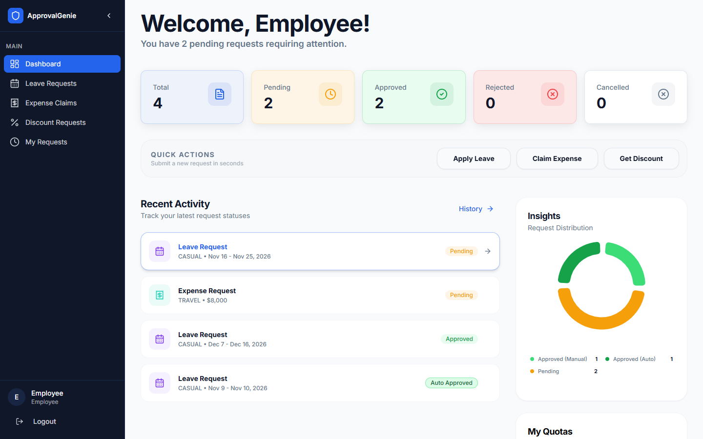
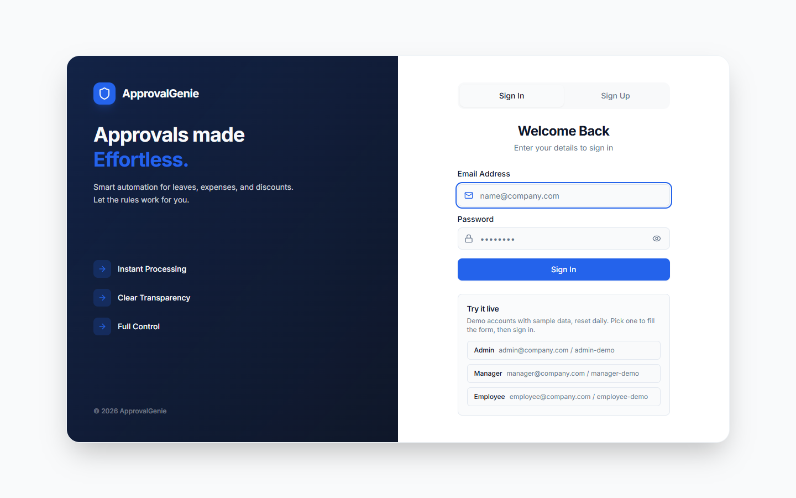
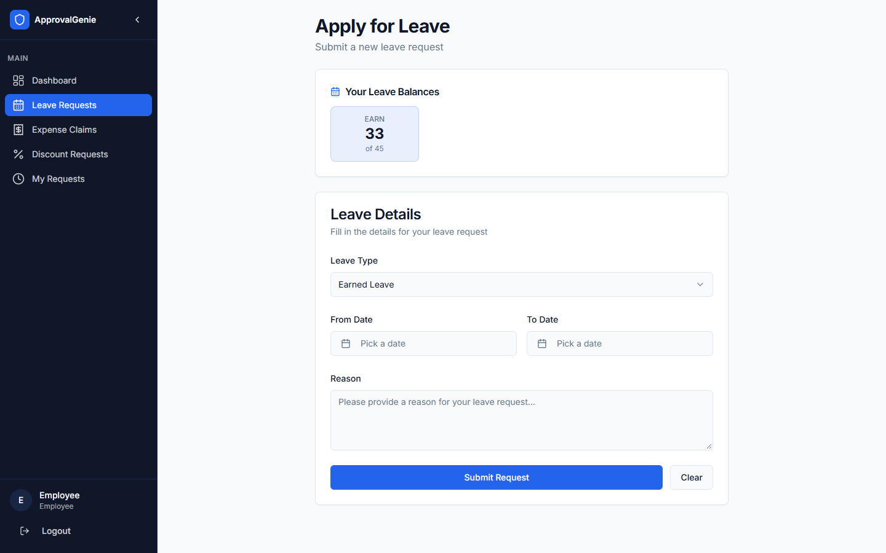
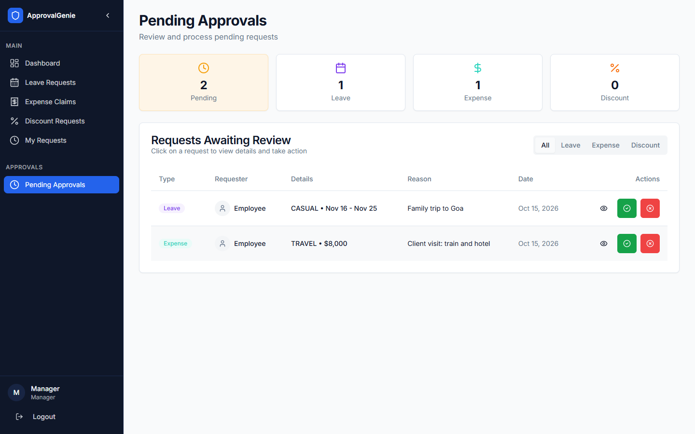
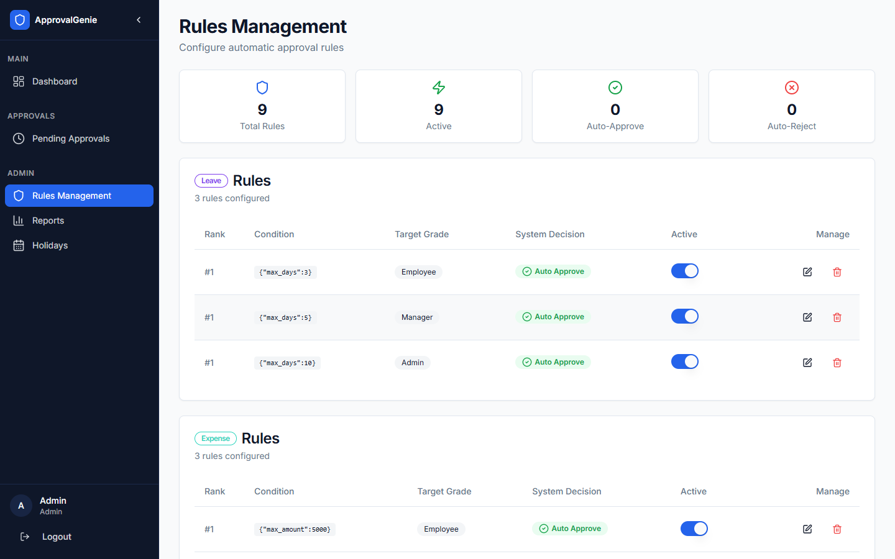
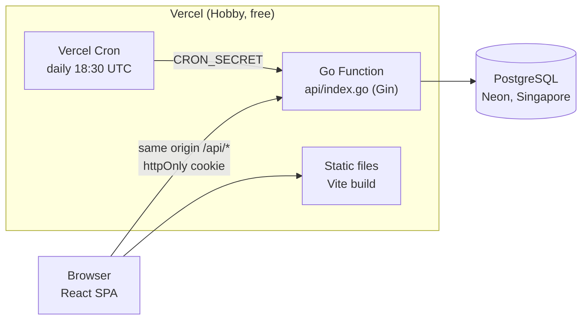
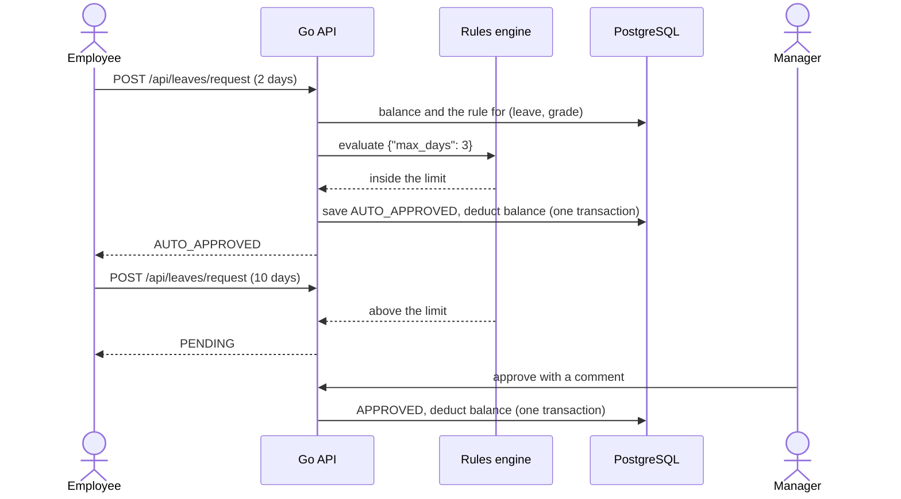

<p align="center">
  
</p>

<h1 align="center">Smart Rule-Based Approval Engine</h1>

<p align="center">
  Leave, expense and discount requests decided by rules the moment they are submitted.<br>
  Inside the rules: approved instantly. Outside: routed to a manager. Forgotten: auto-rejected.
</p>

<p align="center">
  <a href="https://smart-rule-based-approval-engine.vercel.app"><strong>Live demo</strong></a>
  &middot;
  <a href="#try-it-live">Demo logins</a>
  &middot;
  <a href="#architecture">Architecture</a>
  &middot;
  <a href="#run-it-locally">Run locally</a>
  &middot;
  <a href="backend/api/swagger.yaml">API reference</a>
</p>

<p align="center">
  <a href="https://github.com/A-RYAN-1/smart-rule-based-approval-engine/actions/workflows/ci.yml"></a>
  <a href="https://github.com/A-RYAN-1/smart-rule-based-approval-engine/actions/workflows/uptime.yml"></a>
  
  
  
  
</p>

<p align="center">
  <a href="https://smart-rule-based-approval-engine.vercel.app">
    
  </a>
</p>

<p align="center"><sub>Last updated: 2026-10-15 &middot; Live in production on free tiers (Vercel and Neon)</sub></p>

---

## Contents

- [About](#about)
- [Try it live](#try-it-live)
- [Features](#features)
- [Why it exists](#why-it-exists)
- [Architecture](#architecture)
- [Engineering quality](#engineering-quality)
- [Run it locally](#run-it-locally)
- [Environment variables](#environment-variables)
- [Deployment](#deployment)
- [Status and roadmap](#status-and-roadmap)
- [Contributors](#contributors)

## About

In most companies a two-day leave request and a fifty-rupee taxi bill wait in the same queue as a
three-week holiday. This engine decides the routine ones on its own. Each request type has a rule per
employee grade (for example "auto-approve leave up to 3 days for grade 1"); a request inside its rule
is approved the moment it arrives, anything larger goes to the employee's manager, and a nightly job
rejects requests nobody decided within 7 working days. Admins change the rules, holidays and limits
from the UI, without a deploy.

It is for small teams that want approvals to be fast and predictable, and for anyone who wants to
see a rules engine, role-based access and a scheduled job working together in a small, readable
Go and React codebase.

## Try it live

Open **https://smart-rule-based-approval-engine.vercel.app** and sign in with a demo account. The
login page lists them too and fills the form for you.

| Role | Email | Password |
|---|---|---|
| Employee | `employee@company.com` | `employee-demo` |
| Manager | `manager@company.com` | `manager-demo` |
| Admin | `admin@company.com` | `admin-demo` |

Things to try in the first two minutes:

1. As the **employee**, request 2 days of leave: it comes back `AUTO_APPROVED` immediately.
2. Request 10 days: it stays `PENDING`, because grade 1 auto-approves only up to 3 days.
3. Sign in as the **manager** and approve or reject it from *Pending Approvals*, with a comment.
4. Sign in as the **admin**, raise the grade 1 leave limit in *Rules Management*, and submit the 10
   days again as the employee: now it is approved by the rule.
5. As the admin, open *Reports* to see how many requests the rules decided on their own.

These are public demo accounts with sample data. Every night the rules return to the defaults, so
whatever a visitor changes with the admin account is undone. You can also sign up as a new employee.

<table>
  <tr>
    <td width="50%"><p align="center"><sub>Sign in, with the demo accounts listed</sub></p></td>
    <td width="50%"><p align="center"><sub>Leave request with the live balance</sub></p></td>
  </tr>
  <tr>
    <td width="50%"><p align="center"><sub>Manager: requests the rules sent for review</sub></p></td>
    <td width="50%"><p align="center"><sub>Admin: one rule per request type and grade</sub></p></td>
  </tr>
</table>

## Features

- **Three request types**: leave (calendar days, from and to inclusive), expense (amount and
  category) and discount (percentage), each with a balance per employee.
- **Rules engine**: one rule per request type and grade, stored as JSON conditions such as
  `{"max_days": 3}`, `{"max_amount": 5000}` or `{"max_percent": 10}`. Inside the limit:
  `AUTO_APPROVED`; above it: `PENDING` for the manager.
- **Approvals**: managers and admins approve or reject pending requests with a comment; employees
  can cancel their own pending requests.
- **Nightly auto-reject** of requests still pending after 7 working days (weekends and admin-set
  holidays skipped), at midnight India time.
- **Roles**: employee, manager and admin, enforced on the server from the signed session token.
  Sign-up only ever creates employees.
- **Admin**: create, edit and disable rules; manage holidays; status and request-type reports; a user
  overview.

Default rules (from the migrations):

| Grade | Leave auto-approved up to | Expense up to | Discount up to |
|---|---|---|---|
| Grade 1 (new employees) | 3 days | 5,000 | 10% |
| Grade 2 (manager) | 5 days | 10,000 | 20% |
| Grade 3 (admin) | 10 days | 20,000 | 30% |

## Why it exists

We built it to learn how a real approval workflow is put together: business rules that admins can
change without a deploy, roles enforced on the server, and a scheduled job that has to respect
weekends and holidays. Taking it from a working prototype to a public production deploy taught the
rest: configuration that refuses to start when it is unsafe, migrations that work on an empty
database, demo data that resets itself, and tests that run a real Postgres in CI.

## Architecture



How a request is decided:



### Tech stack

| Layer | Technology |
|---|---|
| Backend | Go 1.26, Gin, pgx (PostgreSQL driver), JWT in an httpOnly cookie, embedded SQL migrations |
| Frontend | React 18, TypeScript, Vite, TanStack Query, React Hook Form with Zod, Tailwind CSS, shadcn/ui, Recharts |
| Database | PostgreSQL: Neon (free) in production, Docker locally |
| Hosting | Vercel Hobby: static frontend, Go Function, Vercel Cron |
| CI | GitHub Actions: Go and frontend checks with a Postgres service container; a daily uptime check |
| Toolchain | mise pins Go and Node per project (`mise.toml`) |

### Design decisions

1. **Rules are data, not code.** Each rule is a row with a JSON condition per request type and
   grade, so an admin changes a limit from the UI and the next request uses it. Trade-off: a rule is
   one numeric limit, not a general expression language; anything richer needs code.
2. **One Vercel project for everything.** The SPA, the API (as a Go Function) and the nightly job
   share one origin and one deploy, so there is no CORS to manage and the cookie is first-party, at
   no cost. Trade-off: cold starts on the first request, and Hobby cron runs at most once a day.
3. **The same app runs as a server and as a function.** `server.New` builds the router from a
   `Config`; `backend/cmd/server` wraps it in a long-lived server with an in-process cron, and
   `api/index.go` wraps it for Vercel. Trade-off: startup work (migrations, seed checks) runs on a
   function cold start too.
4. **Migrations embedded in the binary, applied on start.** A fresh database works on the first
   request, each migration in its own transaction. Trade-off: a schema change ships with a code deploy
   rather than as a separate, reviewed step.
5. **Layers with interfaces.** Handlers validate input, services hold the business rules,
   repositories run SQL. Services are unit-tested against mocks and the whole flow against a real
   Postgres. Trade-off: more boilerplate than calling SQL from handlers.

Configuration is read from environment variables in one place (`backend/config/config.go`), which
refuses to start when something required is missing or unsafe (a `JWT_SECRET` under 32 characters,
`CORS_ORIGINS=*`). Every request gets a request id, used in one log line per request; server errors
are logged with it and the client only sees a generic message.

<details>
<summary><strong>Project structure</strong></summary>

```
api/index.go                 Vercel Function entrypoint (wraps the Gin router)
vercel.json                  build, routes, cron, security headers
backend/
  cmd/server/                local server: graceful shutdown, in-process cron, `migrate up|create`
  server/                    builds the app: DB, migrations, seed, services, routes, middleware
  config/                    every environment variable, validated
  app/                       handlers and services per feature (auth, leave, expense,
                             discount, rules, holidays, reports, auto-reject, my requests)
  repositories/              SQL through pgx; repositories/migrations runs the migrations
  migrations/                SQL migrations, embedded into the binary
  seed/                      creates the seed accounts; demo logins and the demo rule reset
  pkg/                       middleware (JWT, roles), errors, responses, utils
frontend/src/
  pages/                     dashboard, request forms, my requests, approvals, admin pages
  services/, lib/api.ts      typed API client
  hooks/, contexts/          TanStack Query hooks, auth context
```

API reference: [`backend/api/swagger.yaml`](backend/api/swagger.yaml) and the Postman collection
[`backend/API.txt`](backend/API.txt).

</details>

## Engineering quality

| Area | What is in place |
|---|---|
| Tests | Go unit tests for services (with mocks), config, JWT and rule helpers; an integration test of the main flow on a real, empty Postgres (migrations, seed, sign-up, auto-approval, manager approval, role checks, cron auth, demo logins, demo rule reset). In all 73 Go test cases (with subtests) and 107 frontend Vitest tests, all passing on 2026-10-15 |
| CI | GitHub Actions on every push: `go vet`, `gofmt`, unit and integration tests with Postgres as a service container, `govulncheck`, frontend lint, tests and build ([ci.yml](.github/workflows/ci.yml)) |
| Uptime | A daily GitHub Actions check of the live site and its database ([uptime.yml](.github/workflows/uptime.yml)) |
| Security | Signing key from `JWT_SECRET` (32+ characters, validated); token in an httpOnly, Secure, SameSite=Lax cookie; roles checked on the server; admin and manager accounts only from the seed, never from sign-up; CORS limited to configured origins; HSTS and X-Frame-Options headers; the cron endpoint requires `CRON_SECRET` |
| Dependencies | `govulncheck`: no known vulnerabilities in reachable code. `npm audit --omit=dev`: one moderate React Router advisory (open redirect through `<Link>`/`navigate` targets); every navigation target here is a fixed path, so user input cannot reach it |

Lighthouse 12.8.2 on the live sign-in page, measured 2026-10-19:

| | Performance | Accessibility | Best practices | SEO |
|---|---|---|---|---|
| Mobile | 97 | 100 | 100 | 100 |
| Desktop | 100 | 100 | 100 | 100 |

Mobile first paint is 1.9 s, largest paint 2.3 s, layout shift 0. Only the sign-in page is audited so far; the pages behind login are not.

Run the checks yourself:

| Command (from) | What it does |
|---|---|
| `go test ./...` (backend) | Unit tests |
| `TEST_DATABASE_URL=postgres://... go test ./server/` (backend) | Integration test of the main flow on a real, empty database |
| `go vet ./...`, `gofmt -l .` (backend) | Static checks |
| `go run golang.org/x/vuln/cmd/govulncheck@latest ./...` (backend) | Known vulnerabilities in reachable code |
| `npm run lint`, `npm test`, `npm run build` (frontend) | ESLint, Vitest, production build |

## Run it locally

Works on Windows (Git Bash), macOS and Linux. You need Git, Docker (for PostgreSQL) and
[mise](https://mise.jdx.dev), which installs the pinned Go and Node versions (or install Go 1.26 and
Node 22 yourself).

1. **Clone and install the toolchain**
   ```bash
   git clone https://github.com/A-RYAN-1/smart-rule-based-approval-engine.git
   cd smart-rule-based-approval-engine
   mise install          # reads mise.toml: Go 1.26, Node 22
   ```

2. **Start PostgreSQL**
   ```bash
   docker run -d --name approval-pg -p 5433:5432 \
     -e POSTGRES_USER=approval -e POSTGRES_PASSWORD=approval -e POSTGRES_DB=approval_engine \
     postgres:17-alpine
   ```

3. **Configure and start the backend** (terminal 1)
   ```bash
   cd backend
   cp .env.example .env
   # edit .env: set JWT_SECRET (openssl rand -hex 32) and the two SEED_*_PASSWORD values
   mise exec -- go run ./cmd/server
   ```
   It applies the migrations, creates `admin@company.com` and `manager@company.com` with your seed
   passwords, and listens on http://localhost:8080 (`curl localhost:8080/health`).

4. **Start the frontend** (terminal 2)
   ```bash
   cd frontend
   mise exec -- npm ci
   mise exec -- npm run dev
   ```
   Open http://localhost:5173. The dev server proxies `/api` to the backend, so the frontend needs no
   configuration. Sign up as an employee, or log in as the manager or admin.

## Environment variables

Backend: `backend/.env.example` lists each one with an explanation.

| Variable | Required | What it is |
|---|---|---|
| `DATABASE_URL` | yes | PostgreSQL connection string. Separate `DB_HOST`, `DB_PORT`, `DB_USER`, `DB_PASSWORD`, `DB_NAME`, `DB_SSLMODE` are also accepted. |
| `JWT_SECRET` | yes | Signs login tokens; at least 32 characters, secret. |
| `SEED_ADMIN_PASSWORD`, `SEED_MANAGER_PASSWORD` | for approvals | Passwords for the built-in admin and manager, created on first start. |
| `SEED_EMPLOYEE_PASSWORD` | no | Password for a built-in `employee@company.com`, created on first start. |
| `DEMO_MODE` | no (default `false`) | `true` publishes the seed logins on the login page and resets the rules on each cron run. Only for a public demo: the seed passwords become public. |
| `COOKIE_SECURE` | no (default `true`) | `false` only for local http. |
| `CORS_ORIGINS` | no | Extra browser origins allowed to call the API, comma-separated. Empty means same-origin only. |
| `CRON_SECRET` | on Vercel | Protects `/api/cron/auto-reject`; Vercel Cron sends it automatically. |
| `GIN_MODE` | no (default `release`) | `release` or `debug`. |
| `PORT` | no (default `8080`) | Port of the local server. |
| `RUN_CRON` | no (default `true`) | Run the nightly job inside the local server. |

Frontend (`frontend/.env.example`): `VITE_API_URL`, empty by default, so the app calls `/api` on its
own origin.

Never commit a real `.env`; only the `.example` files are tracked.

## Deployment

Everything runs on Vercel's free Hobby plan as one project: the Vite build is served as static files,
`api/index.go` is a Go Function serving every `/api/*` route, Vercel Cron calls the auto-reject job
daily at 18:30 UTC (midnight India time), and the database is Neon's free plan through the Vercel
Marketplace. `vercel.json` holds the build, routes, cron and security headers. Pushes to `main`
deploy automatically.

To host your own copy:

1. Import the repository in Vercel (root directory: the repository root; `vercel.json` sets the rest).
2. Add the Neon integration (Storage tab); it sets `DATABASE_URL`.
3. Set `JWT_SECRET`, `CRON_SECRET`, `SEED_ADMIN_PASSWORD` and `SEED_MANAGER_PASSWORD` under Settings,
   Environment Variables (plus `SEED_EMPLOYEE_PASSWORD` and `DEMO_MODE=true` for a public demo like
   this one).
4. Deploy. The first request applies the migrations and creates the seed accounts.

The same backend also runs anywhere a Go binary can (`go build ./cmd/server`): it reads `PORT` and
runs the nightly job in-process.

## Status and roadmap

**Reached:** runs locally from a fresh clone (checked 2026-10-13) and is live in production since
2026-10-13, with CI, a daily uptime check, demo accounts and the security fixes above.

**Known limitations**

- Leave is counted in calendar days, so a request over a weekend uses weekend days from the balance.
- Lighthouse and accessibility checks cover the sign-in page only; the pages behind login have not been audited.
- The first request after a quiet period waits for a function cold start.

**Planned**

- [ ] Audit the pages behind login for accessibility and performance
- [ ] Count leave in working days (the helper `CountWorkingDays` exists; balances do not use it yet)

## Contributors

Built by [Ankita Advitot](https://github.com/Ankita-Advitot) and
[Aryan Deshmukh](https://github.com/A-RYAN-1).

- **Ankita Advitot**: most of the Go backend: the rules engine, request and approval services,
  repositories, the auto-reject job and the API.
- **Aryan Deshmukh**: the React frontend, the deployment, and the production pass (secure
  configuration, migrations that work on a fresh install, tests and CI, the single Vercel deploy, demo
  accounts).
